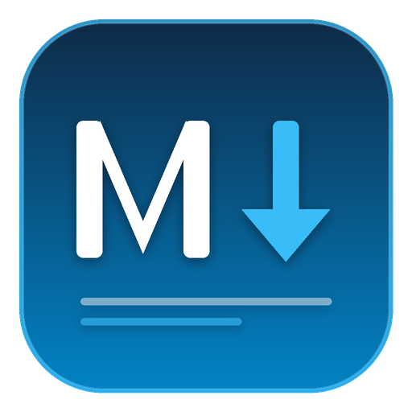

<p align="center">
  
</p>

<h1 align="center">MarkView</h1>

<p align="center">
  <strong>Modern, Ultra-Lightweight Native Windows Markdown Viewer &amp; Editor</strong><br>
  Didesain khusus untuk membuka, membaca, mengedit, dan mengekspor dokumen Markdown (<code>.md</code>) dengan performa instan tanpa browser engine.
</p>

<p align="center">
  <a href="https://github.com/kokofirdaus/MarkView/actions/workflows/build-and-release.yml"></a>
  <a href="LICENSE"></a>
  <a href="https://github.com/kokofirdaus/MarkView"></a>
  <a href="https://dotnet.microsoft.com/"></a>
</p>

---

## 🌟 Mengapa MarkView?

Banyak aplikasi Markdown viewer saat ini dibangun di atas Electron atau WebView2 yang memakan ratusan megabyte RAM hanya untuk membuka berkas teks sederhana. **MarkView** hadir sebagai solusi native murni:

- ⚡ **Zero WebView / No Chromium Engine**: 100% Native Windows Presentation Foundation (WPF) yang dirender langsung via DirectX & GDI+.
- 🪶 **Sangat Ringan & Efisien**: Konsumsi RAM idle sangat minim (< 35 MB) dan waktu peluncuran seketika (*instant startup*).
- 📦 **Single-File Executable**: Mandiri (*self-contained*), tidak memerlukan instalasi runtime .NET tambahan pada komputer pengguna.
- 💻 **Dukungan Multi-Arsitektur**: Tersedia untuk **Windows x64** dan **Windows ARM64** (Copilot+ PC / Surface Pro).

---

## ✨ Fitur Utama

1. **Editor Markdown Berkinerja Tinggi**:
   - Ditenagai oleh **AvalonEdit** dengan syntax highlighting Markdown.
   - Penomoran baris (*line numbers*), pelipatan teks (*word wrap*), dan pembesaran font (*zoom in/out*).
   - Dialog pencarian teks (*find bar*) cepat dengan pintasan keyboard `Ctrl+F`.

2. **Pratinjau (*Live Preview*) Real-Time**:
   - Rendering FlowDocument native via **MdXaml** dengan mekanisme *debouncing* (300ms) untuk mencegah lag saat mengetik.
   - Dukungan penuh untuk tabel Markdown (termasuk *zebra striping*), *blockquotes*, daftar, kode inline, dan blok kode dengan font monospace.
   - Penanganan tautan web (*hyperlink*) aman yang otomatis membuka peramban default pengguna.

3. **Tema Adaptif & Native Immersive Dark Mode**:
   - **Mode Gelap (Dark)**: Standar palet modern VS Code (`#1E1E1E`) dengan kontras teks dan warna tautan (*high-contrast*) yang nyaman di mata.
   - **Mode Terang (Light)**: Bersih dan profesional standar GitHub.
   - **Native Title Bar DWM**: Batang judul jendela Windows 10/11 otomatis berubah menjadi gelap/terang secara native melalui Windows Desktop Window Manager API.

4. **3 Mode Tampilan Fleksibel**:
   - ✏️ **Editor Saja (`Ctrl+1`)**: Menutup panel pratinjau sepenuhnya untuk fokus menulis tanpa distraksi.
   - ⬜ **Split 50/50 (`Ctrl+2`)**: Panel editor dan preview berdampingan dengan pemisah (*splitter*) yang dapat digeser.
   - 👁 **Preview Saja (`Ctrl+3`)**: Menutup panel editor untuk pengalaman membaca dokumen Markdown seperti Microsoft Word / PDF reader.

5. **Cetak & Ekspor ke PDF dengan Pengaturan Halaman**:
   - Dialog konfigurasi tata letak halaman sebelum mencetak atau menyimpan ke PDF (`Ctrl+P`).
   - Pilihan ukuran kertas: **A4**, **Letter**, **Legal**.
   - Pilihan orientasi: **Portrait** atau **Landscape**.
   - Pilihan margin tepi: Normal (25.4 mm), Sempit (12.7 mm), Lebar (38.1 mm).
   - Opsi tema cetak hemat tinta (putih bersih) dan opsi penyertaan header judul dokumen.

6. **Integrasi Windows Explorer**:
   - Mendukung pembukaan file melalui *double-click* (file association `.md` dan `.markdown`).
   - Mendukung *Drag-and-Drop* file Markdown langsung ke jendela aplikasi.
   - Riwayat pembukaan berkas terakhir (*Recent Files*).

---

## ⌨️ Pintasan Keyboard (Shortcuts)

| Pintasan | Fungsi |
| :--- | :--- |
| `Ctrl + N` | Buat berkas baru |
| `Ctrl + O` | Buka berkas Markdown |
| `Ctrl + S` | Simpan berkas |
| `Ctrl + Shift + S` | Simpan Sebagai (*Save As*) |
| `Ctrl + P` | Pengaturan halaman & Cetak / Ekspor PDF |
| `Ctrl + D` | Ganti Tema (Terang / Gelap) |
| `Ctrl + F` | Buka panel cari teks |
| `Alt + Z` | Nyalakan/Matikan pembungkus baris (*Word Wrap*) |
| `Ctrl + 1` | Mode Editor Saja |
| `Ctrl + 2` | Mode Split (Editor & Preview) |
| `Ctrl + 3` | Mode Preview Saja |
| `Ctrl + +` | Perbesar font editor |
| `Ctrl + -` | Perkecil font editor |
| `Ctrl + 0` | Reset ukuran font editor |

---

## 🛠️ Instalasi & Penggunaan

### 1. Unduh Binary Rilis
Silakan unduh binary executable mandiri dari tab [Releases](https://github.com/kokofirdaus/MarkView/releases):
- **Windows x64**: `MarkView-win-x64.exe`
- **Windows ARM64**: `MarkView-win-arm64.exe`

### 2. Instalasi Cepat (Otomatis)
Jalankan skrip instalasi PowerShell di folder `installer/`:
```powershell
powershell -ExecutionPolicy Bypass -File .\installer\install.ps1
```
Skrip ini akan secara otomatis:
- Mendeteksi arsitektur prosesor Anda (x64 atau ARM64).
- Memasang aplikasi ke `%LOCALAPPDATA%\Programs\MarkView`.
- Membuat pintasan di Start Menu dan Desktop.
- Mendaftarkan asosiasi berkas `.md` dan `.markdown`.

Untuk menghapus instalasi:
```powershell
powershell -ExecutionPolicy Bypass -File .\installer\uninstall.ps1
```

---

## 🏗️ Kompilasi dari Source Code

### Prasyarat
- [.NET 8.0 SDK](https://dotnet.microsoft.com/download/dotnet/8.0) atau yang lebih baru.
- Windows 10 (versi 1809+) atau Windows 11.

### Build & Publish

**1. Clone Repository:**
```bash
git clone https://github.com/kokofirdaus/MarkView.git
cd MarkView
```

**2. Build Debug:**
```powershell
dotnet build MarkView.sln -c Debug
```

**3. Publish Standalone Executable (Windows x64):**
```powershell
dotnet publish src/MarkView/MarkView.csproj -c Release -r win-x64 --self-contained true -p:PublishSingleFile=true -p:IncludeNativeLibrariesForSelfExtract=true -p:EnableCompressionInSingleFile=true
```

**4. Publish Standalone Executable (Windows ARM64):**
```powershell
dotnet publish src/MarkView/MarkView.csproj -c Release -r win-arm64 --self-contained true -p:PublishSingleFile=true -p:IncludeNativeLibrariesForSelfExtract=true -p:EnableCompressionInSingleFile=true
```

---

## 🏛️ Arsitektur Proyek

```
markview/
├── .github/
│   └── workflows/
│       └── build-and-release.yml   # CI/CD otomatis untuk x64 & ARM64
├── dist/                          # Output binary siap rilis (x64 & ARM64)
├── installer/
│   ├── install.ps1                # Skrip instalasi otomatis Windows
│   ├── uninstall.ps1              # Skrip uninstaller
│   └── setup.iss                  # Skrip Inno Setup wizard
├── src/
│   └── MarkView/
│       ├── Converters/            # XAML Value Converters (Visibility, Theme)
│       ├── Enums/                 # AppTheme, ViewMode
│       ├── Helpers/               # WindowHelper (Win32 DWM Immersive Dark Mode)
│       ├── Models/                # AppSettings, RecentFile
│       ├── Services/              # FileService, SettingsService, ThemeService, PrintHelper
│       ├── Themes/                # Dark.xaml, Light.xaml, Styles.xaml
│       ├── ViewModels/            # MainViewModel, ViewModelBase, RelayCommand
│       ├── Views/                 # MainWindow, EditorPanel, PreviewPanel, PageSetupDialog
│       ├── App.xaml / App.xaml.cs # Startup, Resource Merging, Crash Logging
│       └── MarkView.csproj        # Proyek .NET 8 WPF
├── .editorconfig                  # Standar format kode
├── .gitignore                     # Filter berkas Git
├── LICENSE                        # Lisensi MIT
├── MarkView.sln                   # Visual Studio Solution
└── README.md                      # Dokumentasi Proyek
```

---

## 👥 Kontributor

Proyek ini dikembangkan secara kolaboratif melalui pemrograman berpasangan (*pair programming*):

- **Koko Firdaus** ([@kokofirdaus](https://github.com/kokofirdaus))  
  *Project Creator, Lead Software Architect, & Maintainer*
- **Antigravity AI** (*Google DeepMind Advanced Agentic Coding*)  
  *Core Contributor, Autonomous AI Pair Programmer, & Code Reviewer*

---

## 📄 Lisensi

Didistribusikan di bawah lisensi **MIT License**. Lihat [LICENSE](LICENSE) untuk informasi lebih lanjut.
